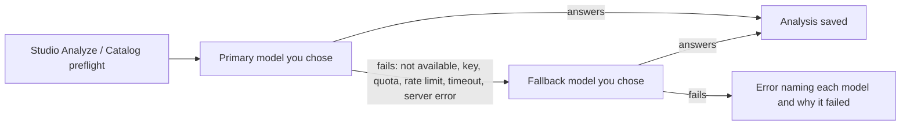

# AI Routing & Model Policies

Youthnic AI Studio runs **the models you choose** in **Administration → AI models**.
For each job you pick a primary model and, where supported, a fallback. The studio tries
the primary first and the fallback chain second (**Meta Muse Spark → Z.ai GLM 5.3 Flash (when configured, 50x concurrency) → OpenAI GPT 6.1 Terra → OpenAI GPT 5.6 Luna → Gemini 3.8 Flash**). It never puts another model ahead of your primary choice.

---

## The three jobs

| Card in Administration | What it does | Fallback |
| --- | --- | --- |
| **Product truth & pose planning** | Reads the uploaded product photos and builds the six-pose plan (Studio **Analyze**, catalog preflight). | Yes |
| **Image QA** | Checks each generated pose against the product photos, when QA is switched on. | Yes |
| **Image Generation** | Generates the final images. | No |

For each card choose **Provider**, **Model** and **Thinking**, then tick **Use a fallback
provider** and choose the fallback's provider, model and thinking.

[SCREENSHOT REQUIRED:
Page: Administration → AI models
Exact State: Product truth & pose planning card with Primary Meta Muse Spark 1.3 Contributor (Medium thinking) and fallback OpenAI GPT 6.1 Terra (Medium thinking), both CONFIGURED.
Exact UI Section: Primary provider and fallback settings.
Recommended Crop: 760x560
Recommended Dimensions: 760x560
Filename: admin-ai-routing-primary-fallback.webp]

---

## When the fallback is used

The fallback runs only when the primary fails for a reason another model can fix:

- the model is not available to the API key (model not found or no access);
- the provider's API key is missing or rejected;
- the budget, quota or billing limit is reached;
- the provider is rate-limiting (including per-minute token `TPM` or request `RPM` limits) or timed out;
- the provider returned an incomplete answer (including an interrupted stream) or a server error.

### High-Throughput Multi-SKU Load Balancing & Z.ai 50x Concurrency Failover

To process **3–6+ SKU analyses per minute** without exhausting Meta's per-minute token limit (`TPM`):
1. **Z.ai GLM 5.3 Flash (`glm-5.3-flash`, 50x Concurrency) as Hop 1 Fallback:** When `ZAI_API_KEY` is configured on the server, any Meta rate-limit, latency spike, or error fails over first to Z.ai GLM 5.3 Flash (native multimodal VLM with forced thinking and **50 concurrent requests**, plus sibling failover to `glm-5.3-flashx` at 200 tok/s) before escalating to OpenAI GPT 6.1 Terra / GPT 5.6 Luna and Gemini 3.8 Flash.
2. **Reserved Fallback Window (`60s`):** Multi-hop Product Truth chains reserve at least `60s` of the gateway budget for Hop 2+, ensuring a slow or timed-out primary hop never starves the configured fallback.
3. **Sibling Load Distribution & 429 Cooldown:** When 2+ concurrent calls are already running on `muse-spark-1.3-contributor`, additional concurrent SKU analyses automatically balance onto `muse-spark-1.2-contributor`. If a Meta model returns HTTP `429` (per-minute token limit), it enters a 45-second cooldown and subsequent requests switch immediately to its sibling or fail over in `0ms` to Z.ai GLM 5.3 Flash / OpenAI `gpt-6.1-terra:medium`.
4. **Superseded Flight Cancellation & Seed-DNA Reuse:** If a user changes reference photos mid-flight, the superseded server flight is aborted immediately so orphaned requests never consume per-minute tokens, and FastAPI `dna.extract` reuses the `studio.analyze` VLM output directly without making a duplicate VLM call.

If the request itself is invalid, for example a rejected image, the fallback is not tried.
A different model would not fix the product photos.

<Note>
**Medium thinking is the recommended default for Product Truth & Pose Planning** on Meta Muse Spark (`muse-spark-1.3-contributor` / `1.2-contributor` / `1.3` / `1.2`), OpenAI **GPT 6.1 Terra** (`gpt-6.1-terra`), and OpenAI Luna (`gpt-5.6-luna`), finishing full 6-photo analysis comfortably inside the gateway window while still preserving explicit **High** thinking when chosen in Administration. Legacy heavy models (`gpt-5.6-terra`, `gpt-5.6-sol`, Gemini Flash) run at **Low** (explicit "none" or "minimal" is preserved; Qwen runs with thinking off). Only if a chain falls into an emergency tight deadline (`< 60s` remaining) is thinking dynamically clamped to **Low** so fallbacks still finish without timing out.
</Note>

---

## Testing a model

Use **TEST** next to the primary and **TEST FALLBACK** next to the fallback. Each sends a
tiny JSON request to that exact model. A pass proves the API key and the model name.
It does not time a full product-photo analysis. Production analysis sends the photos to
the Responses API and only tries Chat Completions when that call returns an error in time to retry.
**CONFIGURED** only means the provider's API key is set on the server.

---

## Reading an analysis error

When analysis cannot run, Studio names every model it tried and the reason each one
failed. For example:

> Every configured vision model failed. OpenAI gpt-5.6-terra: This model is not available to
> the configured API key … · Meta muse-spark-1.3-contributor: Meta Muse Spark is selected for
> vision work but META_MODEL_API_KEY is not configured in Supabase Edge Function secrets.

| The message says | What to do |
| --- | --- |
| *not available to the configured API key* | The provider account cannot use that model. Pick another model, or enable it on the provider account. |
| *… API key … is not configured* | Add that secret to the functions service, or pick a provider whose key is set. |
| *budget or quota is exhausted* | Top up billing with the provider, or switch models. |
| *did not answer in time* | Retry; if it repeats, pick a faster model. |
| *No fallback model is configured* | Tick **Use a fallback provider** and choose one. |

<Warning>
**Muse Spark 1.3 Contributor** is cheaper, but Meta may train on the prompts and product
photos sent to it. Use it only if your organization accepts that.
</Warning>

---

## Next Steps

- Set financial controls in [Costs & Budgets](/admin/costs-budgets).
- Monitor infrastructure telemetry in [System Health](/admin/system-health).
