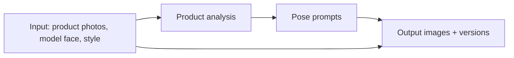

# Inspect Generation Flow

For creative directors, technical merchandisers, and platform administrators, Youthnic AI Studio provides the **Generation Flow board** (`/history/flow/:jobId`).

The board is an interactive node canvas that rebuilds the shoot exactly as it ran, in four groups from left to right: **Input** (the uploaded product photos, the model face and the style reference), **Product analysis** (what the analysis model read and planned), **Prompting** (the stored prompt for each pose) and **Output images** (every generated frame with its own version history).

---

## Opening the Board

Open any generation in History and click **Inspect Pipeline Flow**:

[SCREENSHOT REQUIRED:
Page: Generation Flow (/history/flow/:jobId)
Exact State: Grouped node board: Input (purple), Product analysis (pink), Prompting (teal) and Output images (amber, 3 x 2 grid), with the SKU, status, model and settings chips and the zoom and Fit controls in the header.
Exact UI Section: Fullscreen flow board canvas.
Recommended Crop: 1920x950
Recommended Dimensions: 1400x690
Filename: history-flow-board.webp]

---

## Reading the Board

- **Header** — the SKU, the job status, the analysis model, the image model, the aspect ratio, size and quality, how many poses are done, and the cost so far (or the estimate before the run).
- **Input** — the photos the generator actually received: every product upload (front, back, bottom, fabric, mannequin, additional detail), the **Model face** card, and the style card. The style card is the backdrop authority and reads **Room only, no outfit**; when the shoot's plan matched the reference posture it reads **Room + Pose 4 posture, no outfit** (or Pose 6, or both). Its clothing, face, hair and handheld objects are never used.
- **Product analysis** — the analysis model and thinking level, its fallback models, the product facts it read (category, main colour, fabric, print, neckline and so on), the six-pose plan with the poses that copy the reference posture, and the analysis and Product DNA versions.
- **Prompting** — one card per pose with the pose line, the complete stored prompt (scroll inside the card), and chips for the photos that pose used. **Full prompt** opens it full size with a **Copy** button.
- **Output images** — the current image with its verdict (for example **DNA 95%**, **Needs review**, **Generating** or **Failed**), the thumbnails of the photos that fed it, a change note with **Run**, and a settings bar with the image model, aspect ratio, size, quality, **Download** and **More** (copy link, full prompt, open full size). The arrow next to **Run** lists the saved versions; clicking one opens that exact image full-screen, so no earlier output is ever lost.
- **Connections** — photos connect to the analysis and straight into each output image they fed; the analysis connects to every prompt; each prompt connects to its own image through its text input. Selecting any card highlights its path and fades the rest.

<AccordionGroup>
  <Accordion title="Canvas controls" icon="mouse-pointer">
    **Back** returns to History, **Fit** zooms the whole workflow into view, and the zoom buttons and percentage sit next to it. The board opens fitted to the screen; on a small screen it opens at the inputs at a readable size. Drag a card to rearrange it, drag a group by its title to move the whole group, and drag the canvas to pan. Positions, custom connections, and the viewport you choose are saved automatically for your next visit.
  </Accordion>

  <Accordion title="Per-pose actions" icon="sparkles">
    Each output card exposes **Download** (the original asset through the download API), **Copy link** under **More**, and **Run**. **Run** stays disabled until you type a change note (up to 1,000 characters), because each version is a paid generation. It queues **that pose only** and leaves the current image in place until the new version is saved — earlier versions stay in history as immutable rows.
  </Accordion>

  <Accordion title="Connection rules" icon="git-branch">
    A photo can be wired into any output image, and each pose prompt feeds exactly its own output image. Front poses carry the full product set; a rear pose keeps only the back, bottom, model face, and style room, matching what the generator actually sent for that frame.
  </Accordion>
</AccordionGroup>

---

## Debugging a Bad Frame

If a pose came out wrong:

1. Click the pose card and check its reference thumbnails — they show exactly which photos fed that frame.
2. Open **Full prompt** to verify the stored prompt and product truth.
3. Click the earlier **version row** to compare against the previous output.
4. Type a specific change note and click **Run**. Only this pose is queued; the other five frames stay untouched.

---

## Next Steps

- Export previous shoots in [Download Images & ZIP](/history/download-images-zip).
- Troubleshoot failed jobs in [Failed Generations & Retry](/history/failed-generations-retry).
