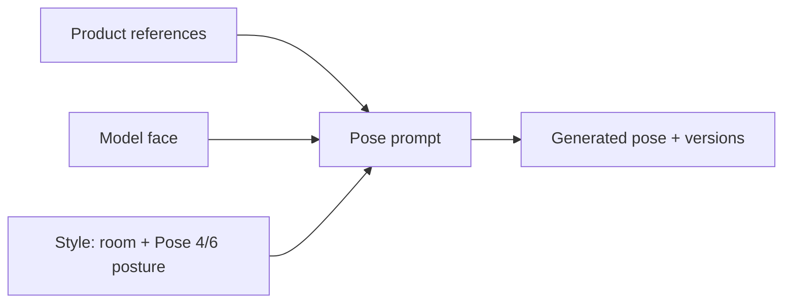

# Inspect Generation Flow

For creative directors, technical merchandisers, and platform administrators, Youthnic AI Studio provides the **Generation Flow board** (`/history/flow/:jobId`).

The board is an interactive node canvas that rebuilds the shoot exactly as it ran: the uploaded product photos, the model face, the style-room reference, the compiled prompt for each pose, and every generated frame with its own version history.

---

## Opening the Board

Open any generation in History and click **Inspect Pipeline Flow**:

[SCREENSHOT REQUIRED:
Page: Generation Flow (/history/flow/:jobId)
Exact State: Node board with product, face, and room references on the left feeding six pose prompt cards and six generated pose cards, with Back, Fit, and zoom controls in the toolbar.
Exact UI Section: Fullscreen flow board canvas.
Recommended Crop: 1920x950
Recommended Dimensions: 1400x690
Filename: history-flow-board.webp]

---

## Reading the Board

- **Reference cards (left)** — every current product upload (front, back, bottom, fabric, mannequin, additional detail), the **Model face** card, and the style card. The style card is the backdrop authority and reads **Room only, no outfit**; when the shoot's plan matched the reference posture it reads **Room + Pose 4 posture, no outfit** (or Pose 6, or both). Its clothing, face, hair and handheld objects are never used.
- **Pose prompt cards (middle)** — the short pose line for each of the six frames. Click **Full prompt** to read the complete stored prompt that was sent to the image model.
- **Generated pose cards (right)** — the current image, the reference thumbnails that fed the pose, the model and settings actually used (for example `gpt-image-2.6-sunburst · 4:5 · 2K · medium`), and one row per saved version. Clicking a version row opens that exact image full-screen, so no earlier output is ever lost.
- **Color-coded connections** — blue lines carry product photos, orange lines carry the model face, green lines carry the style room, and grey lines carry the compiled prompt into the frame. Selecting any card highlights the poses it feeds; selecting a pose highlights the references that fed it.

<AccordionGroup>
  <Accordion title="Canvas controls" icon="mouse-pointer">
    **Back** returns to History, **Fit** zooms the whole workflow into view, and the zoom percentage shows the current level. Drag cards to rearrange, drag the canvas to pan, and use the corner controls to zoom. Positions, custom connections, and the viewport are saved automatically for your next visit.
  </Accordion>

  <Accordion title="Per-pose actions" icon="sparkles">
    Each generated pose card exposes **Copy link**, **Download** (the original asset through the download API), and **Re-generate**. Re-generation requires a change note (up to 1,000 characters), queues **that pose only**, and leaves the current image in place until the new version is saved — earlier versions stay in history as immutable rows.
  </Accordion>

  <Accordion title="Connection rules" icon="git-branch">
    A reference card can be wired into any pose prompt, and each pose prompt feeds exactly its own generated card. Front poses carry the full product set; a rear pose keeps only the back, bottom, model face, and style room, matching what the generator actually sent for that frame.
  </Accordion>
</AccordionGroup>

---

## Debugging a Bad Frame

If a pose came out wrong:

1. Click the pose card and check its reference thumbnails — they show exactly which photos fed that frame.
2. Open **Full prompt** to verify the stored prompt and product truth.
3. Click the earlier **version row** to compare against the previous output.
4. Type a specific change note and click **Re-generate**. Only this pose is queued; the other five frames stay untouched.

---

## Next Steps

- Export previous shoots in [Download Images & ZIP](/history/download-images-zip).
- Troubleshoot failed jobs in [Failed Generations & Retry](/history/failed-generations-retry).
