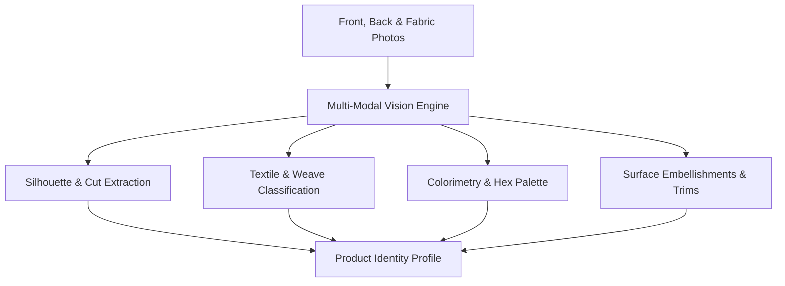

# AI Product Analysis

Before generating a photoshoot, Youthnic AI Studio runs **AI Product Analysis** (`studio.analyze` + Product DNA V2 via LangGraph/FastAPI). By default, it uses **Meta Muse Spark (`medium` thinking)** with **Z.ai GLM 5.3 Flash (`glm-5.3-flash`, 50x concurrency)** as first high-concurrency fallback (when `ZAI_API_KEY` is set) and **OpenAI GPT 6.1 Terra (`medium` thinking) / GPT 5.6 Luna / Gemini 3.8 Flash** next to extract geometric, structural, textile, and color features from your uploaded references (while strictly quarantining style-reference clothing) to build an immutable technical fashion profile and 6-pose choreography. Organizations can customize or disable fallback routes in **Administration → AI models**, and emergency hop budgets under `60s` clamp reasoning to `low`.

---

## Triggering Garment Analysis

Reference images are resized and uploaded to cloud storage in the background immediately as you select or drop them. Once the required product references (for example `Front` + `Back`, or the required 4-slot Saree evidence set) and all selected reference images finish uploading, **AI Product Analysis automatically starts after 1 second (`1000ms`)**. You can also click **Analyze References Now** / **Re-analyze Ground Truth** manually at any time.

- **Non-Interrupting Metadata & Notes:** Typing or editing **SKU Code** or **Product Name** never interrupts or invalidates a running or completed analysis. Typing director notes (**Garment Truth & Construction Notes**, **Scene Direction & Environment**, or **Garment Summary & Invariants**) while an analysis is in progress allows the active run to finish without cancellation.
- **Seed-DNA Zero-Duplicate Fast Path:** As soon as `studio.analyze` locks product ground truth, its extracted `productIdentity` seeds FastAPI's **Product DNA V2** (`dna.extract`), persisting the immutable DNA version without re-downloading images or firing a duplicate VLM request.
- **Multi-SKU Throughput (3–6+ SKUs/min):** Concurrent analyses automatically balance across `muse-spark-1.3-contributor` and `muse-spark-1.2-contributor` inside a 6-slot concurrency limiter, with instant 429 per-minute token limit failover to **Z.ai GLM 5.3 Flash** (50 concurrent requests) and OpenAI `gpt-6.1-terra:medium`.

---

## What the Vision Engine Analyzes

<AccordionGroup>
  <Accordion title="1. Silhouette & Architecture" icon="shapes">
    Detects garment outline, hemline sweep, waistline cinch, slit locations (side slits, front slit), and fit classification (relaxed, tailored, structured, bodycon, flared).
  </Accordion>

  <Accordion title="2. Textile Weave & Fabric Physics" icon="rug">
    Identifies fabric composition (mulmul cotton, raw silk, satin, georgette, chiffon, velvet, linen) and assigns drape stiffness, specular reflectivity, and light translucency values.
  </Accordion>

  <Accordion title="3. Optical Color Extraction (Hex Palette)" icon="palette">
    Extracts the dominant body color, secondary accent colors, and metallic trim colors in exact sRGB hex codes (e.g. `#8B0000` Deep Crimson, `#D4AF37` Metallic Gold Zari).
  </Accordion>

  <Accordion title="4. Neckline, Sleeves & Collar Construction" icon="shirt">
    Identifies precise collar architecture: Sweetheart neck, Scoop, Boat neck, V-neck, Mandarin collar, Halter neck, Raglan sleeves, Bishop sleeves, Cap sleeves, or Sleeveless.
  </Accordion>

  <Accordion title="5. Surface Embellishments & Trims" icon="gem">
    Detects hand-embroidery techniques: Gotapatti, Zardozi, Chikankari, Mirror work, Sequin embroidery, Resham thread work, Foil print, or Block print.
  </Accordion>
</AccordionGroup>

---

## Analysis Confidence Badges

Each detected property displays a confidence indicator badge:
- Green (90–100%): High optical certainty. Directly verified across multiple reference angles.
- Amber (70–89%): Moderate certainty. Suggested based on context (e.g. fabric weave partially obscured by studio shadow).
- Red (Under 70%): Ambiguous attribute. Manual user confirmation recommended.

[SCREENSHOT REQUIRED:
Page: Studio (/studio)
Exact State: Product Identity Profile card showing green, amber, and red confidence badges next to detected attributes.
Exact UI Section: Attribute listing table with confidence badges.
Recommended Crop: 600x380
Recommended Dimensions: 600x380
Filename: studio-analysis-confidence-badges.webp]

---

## Editing & Overriding Extracted Attributes

You have full control over the AI's conclusions. If the vision model detects *"Raw Silk"* but your garment is actually *"Art Silk Blended with Modal"*, click the attribute tag to edit it. The prompt synthesis engine will immediately adjust its latent conditioning weights.

[VIDEO REQUIRED:
Video ID: VID-STUDIO-003
Title: Overriding AI Garment Analysis Attributes
Duration: 14 seconds
Start State: Extracted Product Identity Profile visible.
Actions: Click on 'Primary Color' hex swatch, open color picker, change hex from `#A020F0` to `#800080`. Click on 'Neckline' tag, change from 'Round Neck' to 'Sweetheart Neck'.
End State: Profile shows updated tags with 'User-Modified' badge.
Suggested Filename: studio-override-attributes.mp4
Narration Required: No]

---

## Next Steps

- Explore the complete [Product Identity Profile](/studio/product-identity-profile) documentation.
- Configure [Creative Direction](/studio/creative-direction) to set up your photoshoot environment.
