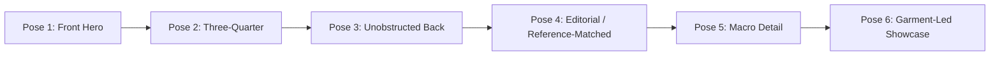
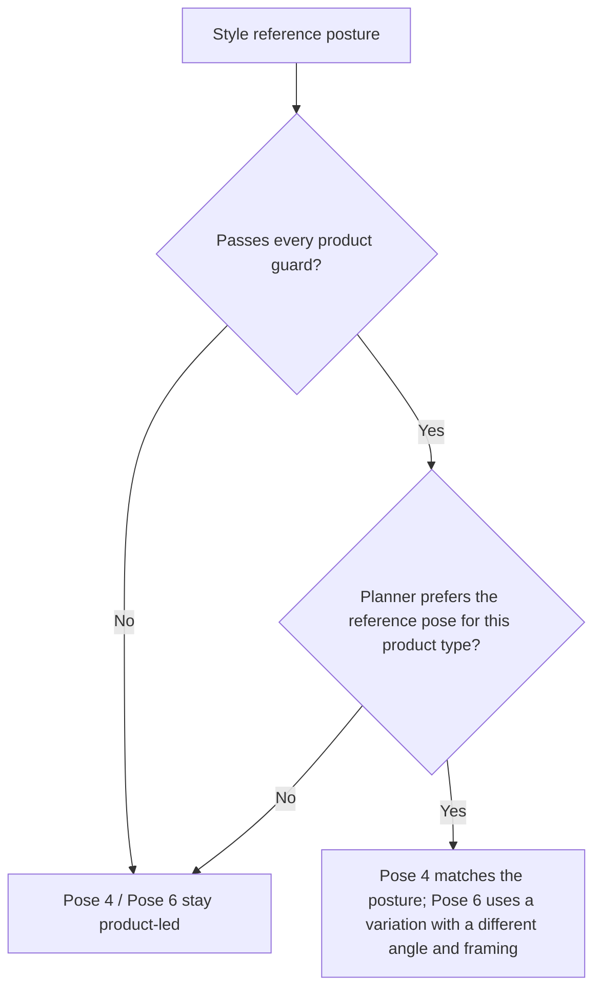

# Pose Planning & Six-Pose Catalog Plan

Every commercial e-commerce listing requires a balanced sequence of perspectives to give buyers confidence in fit, drape, back construction, and fabric texture. Youthnic AI Studio automates this via the **Six-Pose Catalog Plan**, and matches every pose to the garment category it detected.

---

## The Six-Pose Catalog Sequence

[SCREENSHOT REQUIRED:
Page: Studio (/studio)
Exact State: Six-Pose Catalog Plan strip displaying 6 configured pose cards with titles, prompt previews, and camera angles.
Exact UI Section: Six-Pose Catalog Plan configuration card.
Recommended Crop: 1200x380
Recommended Dimensions: 1200x380
Filename: studio-six-pose-plan-strip.webp]

<CardGroup cols={1}>
  <Card title="Pose 1: Front Hero Shot (Primary Listing Image)" icon="user">
    **Framing**: Full-length head-to-toe, centered composition, direct eye contact with camera.
     **Purpose**: Primary search result thumbnail. Displays the natural resting silhouette, hemline drop, balanced shoulder alignment, and overall proportions.
     **Posture**: Upright standing, hands relaxed naturally along hips or light thumb-tuck.
  </Card>

  <Card title="Pose 2: Three-Quarter Perspective (45° Angle)" icon="arrows-split-up-and-left">
    **Framing**: Full-length to mid-calf.
     **Purpose**: Shows side profile, garment depth, sleeve drape, trouser cut, and side slit flare.
     **Posture**: Model body rotated 45 degrees away from the lens, head turned gently back toward camera.
  </Card>

  <Card title="Pose 3: Unobstructed Rear Back View" icon="arrow-rotate-left">
    **Framing**: Full-length rear view.
     **Purpose**: Essential for showing back neckline cut, back yoke embroidery, zipper seams, and tasselled *latkan/dori* ties.
     **Drapery Rule (Critical)**: For ethnic wear with dupattas or stoles, Youthnic's prompt builder enforces an automated rule: the dupatta is neatly pinned or draped forward over the left shoulder, ensuring the back of the garment remains completely visible and unobstructed.
  </Card>

  <Card title="Pose 4: Creative Editorial (Can Match the Style Reference)" icon="couch">
    **Framing**: Medium-full environmental shot.
     **Purpose**: A natural editorial frame that is clearly not a second hero shot.
     **How the posture is chosen**:
    - **Matches the style reference**: when the person in your **Style Reference** sits, leans, kneels or has an unusual signature pose, and that posture suits the product, Pose 4 copies that body position. See **Matching the Style Reference Pose** below.
    - **Seated on request**: if your product notes ask for a seated shot, that request comes first. Pose 4 is seated on furniture that already belongs to the set, with the garment, bottom wear, hem and footwear visible, and it copies the style reference only when that person is seated too.
    - **Otherwise**: a relaxed editorial stance, different from Pose 1, with both feet grounded. A walking stride is never frozen mid-step.
  </Card>

  <Card title="Pose 5: Intimate Detail Close-Up" icon="magnifying-glass">
    **Framing**: Tight torso/bust crop (collarbone to waist).
     **Purpose**: High-resolution focus on tactile elements—buttons, plackets, collar stitching, zardozi embroidery, gotapatti borders, and woven textile grain.
     **Focus**: Macro depth-of-field, soft background blur.
  </Card>

  <Card title="Pose 6: Feature Showcase (Chosen Per Product)" icon="shirt">
    **Framing**: Decided by the analysis, not by a template. The vision model inspects the product references, picks the ONE feature a buyer actually judges this product by, and designs this frame around it.
     **What it can pick**: an embroidered or sequinned yoke, a neckline construction, a sleeve treatment, a print's scale and repeat, the cut and flare of the bottom wear, a hem or border, a dupatta's print/border/length/drape, a saree's pallu, drape style, border or blouse — or any other genuinely distinguishing detail.
     **Shot type**: also chosen — `macro_detail` (fill the frame), `half_body_detail` (crop to the section it sits on), `full_body_feature` (needs the whole garment: flare, length, fall), `drape_feature` (a held or spread panel), or `movement_feature` (fall and flare in motion).
     **Non-duplication (enforced)**: it may not be a second hero shot, and it may not re-shoot Pose 5's subject. If the strongest feature is already Pose 5's close-up subject, the frame is automatically widened so it shows how that feature sits on the worn garment instead of re-cropping the same detail.
     **Style reference posture**: when the plan matches Pose 6 to the style reference, it uses a variation of that posture with a different camera angle and framing from Pose 4, as long as the showcase feature still reads. Model, product, set and styling stay identical to Poses 1–5.
  </Card>
</CardGroup>

---

## Garment-Aware Pose Grammar

Body language is selected from the garment category, never from a generic ethnic-wear prior. The same locks on design, print, motif scale, colour, fit and construction apply in every frame - only pose, angle, framing and expression change.

| Detected family | Pose grammar applied to every frame |
| --- | --- |
| Bengali saree (tant, jamdani, garad, korial, baluchari, lal-paar, aatpoure drape) | Upright, serene posture; pallu/aanchal on its recorded shoulder with artwork and border readable; flat vertical pleats; continuous borders; hands clear of the pallu |
| Ethnic / traditional saree | Graceful, unhurried posture that never disturbs the drape; pallu follows the drape plan exactly and stays one continuous panel |
| Kurti / kurta set with bottom wear | Every frame proves fit, true length, sleeve shape and the complete set; dupatta kept off the yoke, placket, slit and bottom wear |
| Standalone long kurti | Fall, fit and hem length; never hitched, tucked or gathered |
| Short kurti / top | Playful, natural, lively movement that interacts with the established backdrop while the garment stays unobstructed |
| Lehenga | Choli, dupatta and the complete skirt flare with volume preserved |
| Dress / gown / western-casual | Relaxed current body language showing the complete silhouette, hem level and in frame |

---

---

## How Pose 6 Is Chosen, and How It Learns

The sixth frame is the only one without a fixed job, and the analysis records its decision in `showcasePlan`: the named feature, its garment region, the shot type, why it sells, the reference that proves it, and one line stating how the frame differs from Poses 1 and 5.

Those decisions are scored by what your team actually does with them:

| Signal | Recorded as |
| --- | --- |
| A reviewer approves the sixth pose version, or approves the whole set | `selected` |
| A reviewer rejects the sixth pose version | `rejected` |
| Anyone asks for the sixth pose to be regenerated | `regenerated` |
| Automatic QA refuses the sixth pose | `qa_failed` |

Counts are kept per organization, category, garment family, feature region and shot type — never per SKU — and fed back into later analyses as a short "what this team kept and threw away" note. It breaks ties between comparably strong features and steers away from a framing your team keeps sending back. It is house taste, not product truth: when the references clearly make a different feature the strongest one, the analysis follows the references.

## Bottom-Wear Presentation

**Output settings → Bottom wear** decides how the shoot treats a bottom garment. It is a presentation choice: the analysis still records exactly what the references prove.

| Setting | Behaviour |
| --- | --- |
| `Auto` (default) | Follows the analysis. Bottom wear recorded in the references gets full-body top + bottom framing; a SKU with no recorded bottom is treated as top-only. |
| `Outfit includes bottom wear` | Forces full-body top + bottom framing and the bottom-wear silhouette, colour and print locks, even when the analysis under-recorded the bottom. |
| `Top only` | The upper garment is the product. Coordinated or "matching" bottom wear is prohibited: the model wears one plain, neutral, unbranded bottom that never repeats the product's print, motif, embroidery, border, colour blocking or fabric, and is never presented as a second product piece. |

Automatic QA follows the same setting, so a top-only shoot is never failed for bottom-wear fidelity it was told not to render.

---

## Matching the Style Reference Pose (Pose 4 and Pose 6)

The analysis records how the person in your style reference is posed: standing, seated, leaning, kneeling, crouching, reclining or walking, what they rest on, and whether the pose is an unusual "signature" pose (for example a floor sit with one knee raised, or a doorway lean). It records the body position only.

Only **Pose 4** and **Pose 6** can copy that posture. Poses 1, 2, 3 and 5 always stay catalog frames.

The posture is **never** copied when:

- the style reference shows no person, or a plain standing pose;
- the analysis judged the posture unsuitable for this product;
- it is a walking stride or a lifted foot, which would freeze mid-step;
- the bottom wear is a Farshi salwar and the posture is folded (seated, kneeling, crouching, reclining), because the Farshi two-leg volume and hem taper need a standing frame;
- the product is a saree and the posture is reclining, which breaks the pleats and pallu fall;
- for Pose 4 only: your product notes ask for a seated shot and the reference person is not seated (Pose 4 is seated as you asked);
- for Pose 6 only: the showcase is a tight detail crop, or the posture is folded and the showcase is a movement shot or a feature that needs a full-length standing view (bottom wear, hem or border, silhouette, complete set).

Only the body position and attitude are copied. The style reference person's **outfit, face, hair and anything in their hands are never copied** into any frame, unless your product notes ask the model to hold or carry a prop (for example "she holds a coffee glass and a hand bag as in the reference image"): then that prop is carried over in every frame except the Pose 5 close-up. Jewellery follows the styling plan. Any seat or support must already be part of the shoot's set.

In **Studio → 6-Pose Fashion Catalog Plan**, a matched pose shows a **Matches reference · seated** (or leaning, kneeling…) badge. **Scene & Creative Direction → Inspect Extracted Vision Profiles** lists the style reference posture, whether Pose 4 and Pose 6 match it or stay product-led, and the expression plan.

### How the planner learns

Each matched or product-led decision is recorded per organization, product type and bottom-wear cut, together with whether the delivered images passed the product consistency check and whether reviewers approved or rejected them. When a posture keeps failing the check or keeps getting rejected for a product type, later shoots of that type stay product-led; when it keeps passing and being approved, it is preferred. The guards above always apply first.

### Asking for a seated Pose 4

Write it in the product notes (for example "seated shot on the bench"). Pose 4 is then seated on furniture that already belongs to the set. Your request comes before the style reference: Pose 4 copies the reference posture only when that person is seated too. A seated person in the style reference is not treated as a request; it goes through the posture matching above.

---

## Expression Planning

The analysis also plans one expression for the whole shoot from the style reference person's attitude and the product: an attitude, an energy (serene, calm, warm, playful, confident or dramatic), a gaze and a smile level. Every frame adapts that plan to its framing. Pose 5 follows its close-up mode: a product-detail crop keeps the face out of frame, while a face-and-detail close-up uses the planned expression. Expressions stay natural; a forced or toothy grin is never requested. The pose detail in Studio shows the planned attitude under **Expression**.

Analyses made before this feature have no expression plan. Their poses keep the earlier behaviour: no posture matching, no planned expressions and no attitude line.

---

## Product Consistency Check

Every generated pose is checked against your product photos before it is accepted, whether or not automatic QA is on. The check scores five things: **shape**, **colour**, **material**, **logo** and **details** (embroidery, print, trims and their placement).

- If any score falls below the pass mark, the image is saved to the rejected archive instead of being deleted (unless storage is unavailable) and the pose is regenerated within the normal retry limit. If the last attempt fails only this check (automatic QA, when on, passed it), that image is kept and marked for human review instead of being discarded.
- If the check itself cannot run, the image is still delivered and marked unverified.
- When full automatic QA is on, the same five scores come from the QA review, so no second check is made.

History shows the result under **Product consistency check** in the pose viewer: Passed, Failed or Unavailable, with the five scores.

---

## Disabling or Reordering Poses

Not every catalog requires all 6 poses:
- Toggle the switch on the top right of any pose card to **Enable/Disable** it. Disabled poses will not consume generation credits.
- Drag cards horizontally using the handle icon `::: ` to change the sequence order.

---

## Next Steps

- Proceed to [Generate Photoshoot](/studio/generate-photoshoot) to trigger rendering.
- Learn about [Quality Validation](/studio/quality-validation) scorecards.
